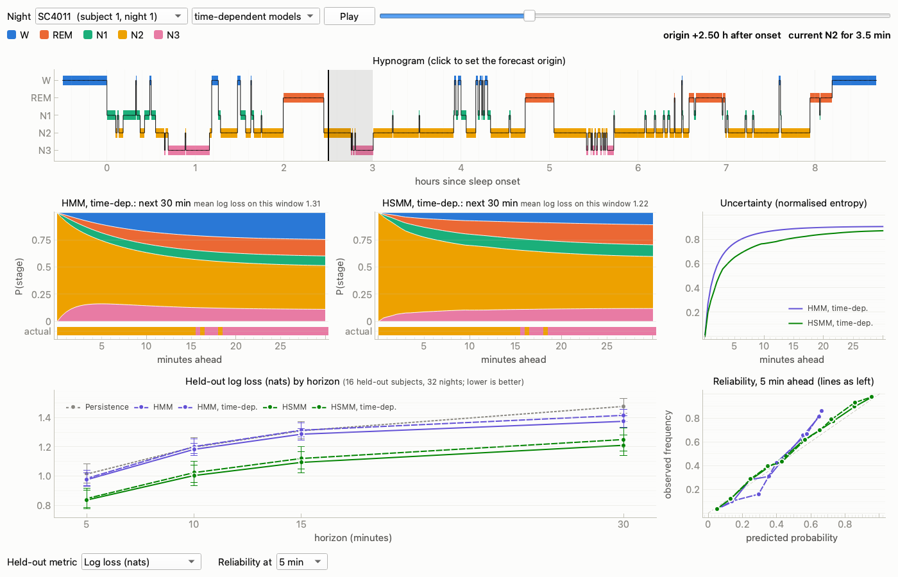
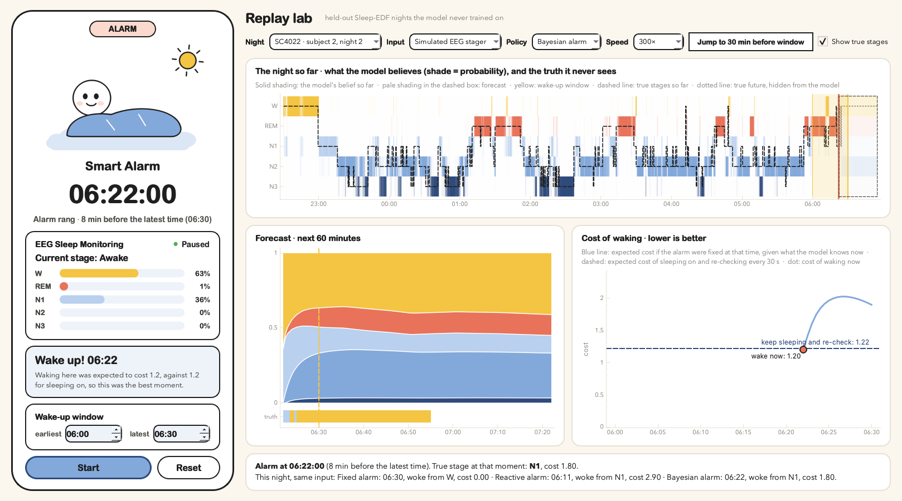

# oxford-neurotech-hack

Live EEG and motion from a g.tec **BCI Core-8** (8 ch, 250 Hz, Bluetooth LE) on macOS, via
g.tec's [g.Pype](https://gpype.gtec.at/) SDK, plus a cue program and an offline decoder for
task experiments.

```
tasks.py ──UDP markers──┐
BCICore ────────────────┴─> Router ─┬─> HDF5 file (raw EEG + markers)        acquire.py --record
   │  [--oscar artifact removal]    └─> 50 Hz notch ─> 1–40 Hz bandpass ─┬─> live scope
   │                                                                     └─> LSL "core8_eeg"
   └─ accelerometer / gyroscope ─────────────────────────────────────────────> LSL "core8_motion"

calibrate.py / tasks.py check:  LSL "core8_eeg" ─> per-channel amplitude, drift, muscle ─> pass/fail
decode.py:  HDF5 ─> zero-phase filters ─> epochs per task ─> band power ─> LDA + cross-validation
receive.py: any LSL stream ─> per-channel mean/std every second (+ optional CSV)
neurofeedback/: LSL "core8_eeg" (or CSV / simulator) ─> PO7/POz/PO8 alpha z-score ─> cumulative reward dashboard
sleep/:     Sleep-EDF hypnograms ─> HMM / duration-aware HSMM ─> stage forecasts 5–30 min ahead (smart-alarm groundwork)
smartalarm/: stage probabilities (replay / simulated stager; EEG later) ─> online HSMM ─> wake-or-wait policy ─> alarm app
dance/:     LSL "core8_raw" (unfiltered) ─> block CSVs ─> window features ─> random forest ─> live moves
```

| file | what it does |
|---|---|
| `acquire.py` | headset → filters → scope + LSL; records raw EEG + task markers with `--record` |
| `motion.py` | `BCICore` subclass that also publishes the accelerometer and gyroscope over LSL |
| `calibrate.py` | live per-channel contact check plus an eyes-closed alpha test; writes a pass/fail report |
| `quality.py` | the signal-quality metrics and thresholds used by `calibrate.py` and `tasks.py` |
| `tasks.py` | full-screen task cues, randomised trials, sends markers to `acquire.py`; refuses to start on bad channels |
| `decode.py` | offline decoding of the recorded tasks, with chance level and a permutation test |
| `receive.py` | standalone pylsl reader, e.g. for checking streams or saving them to CSV |
| `dance/` | dance-move classifier: record, train, decode live with a dashboard (see below) |
| `neurofeedback/` | eyes-closed posterior-alpha neurofeedback with a live reward dashboard (see below) |
| `sleep/` | probabilistic sleep-stage forecasting (HMM and HSMM) for a future smart alarm (see below) |
| `smartalarm/` | Bayesian smart alarm: online HSMM tracking, optimal-stopping wake-up, replay app (see below) |

## Setup

Python 3.10–3.14 (tested with Homebrew Python 3.13, gpype 4.1.0).

```bash
python3.13 -m venv .venv
.venv/bin/pip install -r requirements.txt
git clone https://github.com/gtec-medical-engineering/gpype ../gpype   # examples, for reference
```

### Bluetooth permission (macOS)

macOS grants Bluetooth to the **app that launches Python**, not to Python itself.

1. Open **System Settings → Privacy & Security → Bluetooth**.
2. Turn on the app you run the scripts from (Terminal, iTerm, VS Code, PyCharm…).
   If it isn't listed, run `acquire.py` once and macOS should ask. Otherwise add it with **+**.
3. **Quit and reopen that app.** The permission only applies to a fresh process.

Without this, the BLE scan quietly returns nothing and it looks like the headset is off.

## Running an experiment session

Switch on the headset. g.Pype finds it by BLE scan, so you do not pair it in System Settings.

```bash
# Terminal 1: acquire + record. Leave it running for the whole session.
.venv/bin/python acquire.py --record data/p01_s1.h5          # add --oscar for artifact removal

# Terminal 2: fix the electrodes until every channel is green, then do the alpha check
.venv/bin/python calibrate.py

# Then run the session. It re-checks the signal for 5 s and won't start on a red channel.
.venv/bin/python tasks.py --tasks rest_open rest_closed math --trials 15 --log data/p01_s1_tasks.csv

# When tasks.py says "Done", close the scope window to finish the file. Then:
.venv/bin/python decode.py data/p01_s1_*.h5
```

`--record` adds a date and time to the file name, e.g. `data/p01_s1_20261107_150102_123.h5`.

- **Tasks** (`tasks.py --tasks …`): `rest_open`, `rest_closed`, `left_hand`, `right_hand` and
  `feet` (motor imagery), `math` (serial subtraction), `words` (word generation). The marker
  codes are fixed in `TASKS` in `tasks.py`. Add your own there.
- **Trial structure:** fixation cross for 2–3 s, then the cue for `--duration` s (default 5),
  with a beep at the start and end of each cue. There's a break every 20 trials. Press Space
  to start or continue, Esc to abort. The trial order is randomised and balanced, and written
  to the `--log` CSV.
- **Decoding:** `decode.py` epochs each task from 0.5 to 5 s after the cue and drops epochs
  over 150 µV peak-to-peak. Before rejecting, it prints each channel's median epoch
  peak-to-peak and drops channels over 2× the median (`--bad-factor`, or name them with
  `--exclude Fz C4`). `--tasks math rest_open` decodes a subset of the tasks.
  It takes log theta, alpha, beta and gamma power per channel
  (32 features) and runs a shrinkage-LDA classifier with 5-fold CV. It prints accuracy,
  chance level, a permutation p-value, the confusion matrix and the most discriminative
  features. Pass several files to pool sessions.

### Choosing tasks for 8 channels (Fz C3 Cz C4 Pz PO7 POz PO8)

- **Start with `rest_open` vs `rest_closed`.** Closing the eyes raises alpha (8–13 Hz) at
  PO7/POz/PO8, which almost always decodes. If this fails, fix the setup before trying
  harder tasks.
- **`math` / `words` vs rest** is usually decodable from frontal theta and changes in
  posterior alpha.
- **`left_hand` vs `right_hand` imagery** shows up as mu/beta desynchronisation at C3/C4.
  It is weak without training. Expect near chance in a first session.
- **Watch for confounds.** A decoder will happily learn from eye movements, blinks, jaw
  tension or head motion if they differ between tasks, e.g. eyes moving while reading the
  math cue. If the top features are Fz or gamma, or the motion stream differs between
  tasks, suspect artifacts. Keep cues short and have the participant fixate and stay still.
- **Aim for ≥ 30 clean trials per class.** With 15 per class, accuracies swing a lot, so
  rely on the permutation p-value.

## Dance-move classifier (`dance/`)

This classifies 7 moves (spin, arm pumps, bounce, stand still, the robot, the floss, head bob)
from movement artifacts and EMG, the opposite of what the rest of the repo tries to do. It uses
the unfiltered `core8_raw` stream, because the 1–40 Hz filter on `core8_eeg` removes both slow
head motion and EMG. The motion stream is not used.

| file | what it does |
|---|---|
| `dance/config.py` | moves, window sizes and online settings. **Add or remove a move here.** |
| `dance/stream.py` | sources: live LSL or replay of a recorded CSV (same interface), and labels from markers |
| `dance/record.py` | full-screen cues for one block (chained sequences, or single trials); writes `data/dance/<subject>_b<block>.csv` |
| `dance/features.py` | per-window features, shared by training and live |
| `dance/train.py` | leave-one-block-out evaluation against a majority baseline, then saves the model |
| `dance/live.py` | decoding (Space start/stop by default, or continuous) with the dashboard |

```bash
# Terminal 1, whole session (the HDF5 is a backup; dance/ records its own CSVs)
.venv/bin/python acquire.py --record data/dance/p01.h5
# Terminal 2: contact check while sitting still, then one block (~4 min); repeat for more blocks
.venv/bin/python calibrate.py --no-alpha
.venv/bin/python -m dance.record --subject p01 --block 1
# Train (after 2 blocks already, to check the moves are separable at all)
.venv/bin/python -m dance.train data/dance/p01_b*.csv --out models/p01.joblib
# Decode live: Space to start, Space to stop -> top move
.venv/bin/python -m dance.live --model models/p01.joblib
# Continuous decoding, live or replaying a block the model has not seen
.venv/bin/python -m dance.live --model models/p01.joblib --mode continuous
.venv/bin/python -m dance.train data/dance/p01_b*.csv --holdout 5 --out models/p01_no5.joblib
.venv/bin/python -m dance.live --model models/p01_no5.joblib --mode continuous --replay data/dance/p01_b5.csv
```

**Recording, `--protocol sequence` (the default).** Moves are chained the way they are danced
live: a sequence is 7 moves back to back (`--seq-len`, default: one per move), each lasting a
random 3–6 s (`--segment`), with a beep and a new marker at every switch and no rest in
between. During the last second of each move the screen shows "then: NEXT MOVE" so the dancer
flows straight into it. Sequences are separated by a 10 s break (`--break`). Each block has
every move 5 times (`--reps`), never twice in a row, so 5 sequences, about 3.5 min and 30
transitions per block. Stand still is one of the moves, so the data also has move → still →
move. The dancer keeps repeating each move until the cue changes, never just once. Compared
with the discrete protocol, this gives the classifier real move-to-move transitions, variable
durations (so it can't learn trial timing), and a replay that looks like live use.

The recording window shows the cues on the right and the electrodes on the left, like
`acquire.py`'s scope: the last 10 s of the 1–40 Hz `core8_eeg` stream, ±50 µV per channel
(`--scale`), with a dashed line labelled with the move at every marker. A flat line there is a
dead electrode. `--no-scope` hides it.

**Recording, `--protocol discrete`.** The original trials: rest (2–3 s), "Next: MOVE" (1 s),
GO (beep, 4 s of dancing, `--duration`), STOP (beep). Blocks of both kinds can be trained on
together.

In both protocols the marker codes (13–20, end of a run = 99) travel over UDP into
`acquire.py`, so they sit in channel 9 of the same stream as the EEG. A move code ends the
current segment and starts the next one. The CSV is `time, Fz..PO8, marker`, with the time on
gpype's clock. At the end, the recorder prints the sample rate, the segments it found per move
(against the number cued, so lost markers show up) and how many move-to-move transitions it
covered.

**Changing moves.** Codes are fixed once recorded. Step-touch (11), rock step (12) and
shoulder shimmy (14) were retired, as they were confused with spin and with the arm moves:
blocks recorded with them still load, and their trials are skipped. Never reuse a retired
code. To leave a move out without retiring it, pass the moves to keep:
`dance.record --moves rest floss robot bounce spin head_bob` records only those (seq3), and
`dance.train --moves ...` trains on only those, e.g. to drop arm pumps from seq2 blocks.

**Features** (per 1.5 s window, every 0.25 s): only each channel's mean is removed, nothing
else is filtered. Per channel: log RMS, log RMS of the first difference, and log band power at
0.5–3 Hz (motion), 3–8, 8–13, 13–30, 30–45 and 55–95 Hz (EMG, skipping 50 Hz mains). Plus the
28 channel-pair correlations. The first 0.5 s after each cue counts as no move (reaction
time). By default (`--purity 1`) training uses only windows that lie fully inside one segment.
`--purity 0.67` also keeps windows that straddle a transition, labelled with the move that
fills at least 2/3 of them, which is what the live decoder sees during transitions. On the
two discrete blocks this made no clear difference (there, the edge windows are move + standing
around a cue, not move → move); compare the two with the replay scores below once you have
sequence blocks.

**Leaving out an electrode.** `dance.train ... --exclude POz` (several allowed, any case) drops
every feature that uses that electrode: its 8 per-channel features and its 7 correlations. The
saved model remembers this, and `dance.live` drops the same features, so nothing else changes.

**Evaluation.** Leave-one-block-out, so overlapping windows from one block are never in both
train and test. It prints accuracy and macro-F1 for the random forest and the majority
baseline, the confusion matrix, a per-class report and the top features.

**Online, `--mode continuous`.** It runs the classifier every 0.25 s on the last 1.5 s. By
default the decoder is winner-takes-all: the top move of every step is shown at once. For a
steadier display, average the probabilities (`SMOOTH_ALPHA` < 1) and switch only after another
move has been ≥ `THRESHOLD` for `MIN_DUR_S`. Each change is printed with its LSL timestamp. In replay it also scores the
decoded sequence against the cues:
- *step accuracy*: decoded == cued, every 0.25 s
- *segments detected*: the cued move was decoded at some point before the next cue
- *latency*: from the cue to the first correct decode (median and 90th percentile)
- *sequence accuracy*: 1 − edit distance / length between the decoded and cued order of
  moves, ignoring stand still. This is the score for "did we get the dance right".

`--no-gui` prints only the transitions, and `--speed 0` replays as fast as possible.

`SMOOTH_ALPHA`, `THRESHOLD` and `MIN_DUR_S` trade latency for stability. On p01's two seq2
blocks (train on one, replay the other), winner-takes-all (`1.0, 0.0, 0.0`) detects 0.94–0.97 of
cued moves with ~1.7 s median latency and 0.60 step accuracy. But it flickers: 99–125 decoded
moves for ~29 cued, so sequence accuracy is negative. Smoothing (`0.4, 0.5, 0.75`) detects only
0.54–0.57 of cued moves at ~3 s latency, with 0.28 step accuracy and 0.57–0.66 sequence accuracy.
Use winner-takes-all to show the dancer what is decoded right now, and smoothing to read out the
dance as a sequence. The dashboard shows the raw EEG, per-channel quality (meaningful only when
still), the decoded move as its avatar from `figures/` (`MOVE_GIFS` in `dance/config.py`: an
animated GIF, or a still image like rest's), its confidence, the probabilities, and the decoded and cued
moves over time.

**`--demo`** is continuous decoding laid out for an audience:
`python -m dance.live --model models/<model>.joblib --demo`. It drops the EEG traces. The
mirrored computer camera goes top left (`--camera N` picks another camera), and dials go bottom
left for smoothing, threshold, hold time and update interval. The dials change the decoder while it runs, and
**Instant** / **Steady** set the two presets above. On macOS, the first run asks to give your
terminal app camera access.

**Online, `--mode discrete` (the default).** Press Space to start, dance, then press Space
again to stop. The captured stretch is cut into the same 1.5 s windows as in training and their
probabilities are averaged. The dashboard shows the top move and all the probabilities. The
terminal prints the top three with the capture's LSL start and stop times. A capture needs
at least 1.5 s. This mode needs the dashboard, so `--no-gui` works only with
`--mode continuous`.

**Check on the device before collecting data.** None of this has been run on the headset.
- `receive.py --stream-name core8_raw` should show 9 channels at about 250 samples/s. This
  checks that a second gpype `LSLSender` on the unfiltered Router output works.
- Shake your head and check the raw units, DC offset and saturation in the mean/std output.
- Record a short block (`--reps 1`). The summary should show about 250 samples/s, which
  rules out Bluetooth dropouts while dancing, and one segment per move, which shows that
  codes above 9 pass through `UDPReceiver`.
- The LSL timestamps are gpype's `time.monotonic()`. Don't mix them with
  `pylsl.local_clock()`.

**Without the headset:** `acquire.py --simulate`, then `dance.record --subject sim --block 1
--reps 2 --skip-check` (twice, blocks 1 and 2), then `dance.train`. It should score near
chance, which shows the whole chain runs.

## Tandem: alpha neurofeedback (`neurofeedback/`)

A dashboard that rewards sustained increases in posterior alpha (8–12 Hz) over a 60 s eyes-open
resting baseline. The score reflects sustained modulation of one EEG feature. It is **not** a
validated measure of meditation depth.

```bash
# Live: acquire.py streams core8_eeg, then
.venv/bin/python acquire.py                      # terminal 1
.venv/bin/python calibrate.py                    # terminal 2: get the electrodes green first
.venv/bin/python -m neurofeedback --participant p01   # terminal 2
# No headset
.venv/bin/python -m neurofeedback --source sim --speed 5
.venv/bin/python -m neurofeedback --source sim --ui both      # user view + debug view
.venv/bin/python -m neurofeedback --source csv --csv data/dance/p01_b1.csv
```

There are two windows. The **user view** (default) is for the participant, styled as flat ink
on paper with splashes of colour. It shows a breathing line-art meditator on a colour blob,
grey at rest and turning yellow as alpha nears the threshold (blue while calibrating, coral
for poor signal, mint when done). The figure's eyes are open during calibration and closed
during the session, and it smiles more as alpha rises. Below it are the points, a status tag,
one reward curve and one button. Since the participant's eyes are closed, the feedback is mainly sound:
- a soft bell for every reward point, with notes wandering over a pentatonic scale like wind chimes
- a deeper bell every 10 points
- a quiet ambient pad that swells as alpha approaches the threshold
- cues when calibration starts and ends

Before starting, the participant picks a **timed** session (minutes, with a countdown; it
ends by itself) or an **open-ended** one (it runs until **End session**). Both can be paused
and resumed, and a pause stops the countdown. Poor-signal windows don't stop the clock; they
just earn nothing. The reward curve shows the previous personal best for that session mode as
a dashed target line. Passing it rings a bell, and a cue sounds when the session ends.
Calibration is eyes open (gaze resting on the orb). The session starts by itself afterwards,
in the chosen mode (`--no-auto-start` turns this off).

**Session history.** Every completed session, whether ended by the timer, by **End session**
or by closing the window, is appended to `data/neurofeedback_sessions.csv` (`--history`):
participant (`--participant`), end time, mode (`timed`/`indefinite`), planned minutes,
score, active duration (excluding pauses), clean duration, how it ended, whether it was a
personal best, threshold and channels. Personal bests are per participant and per mode, read
back from this file. The score is deliberately not normalised by duration, so longer
sessions can score more.

Keys: Space start/pause, M mute, F full screen. `--mute` starts silent.
The sounds are synthesised in `neurofeedback/sounds.py`, so no audio files are needed. The
**debug view** (`--ui debug`, or `--ui both` for the experimenter's screen) has the plots and
controls described below.

In the debug window: **Start baseline calibration** (60 s, eyes open, resting), choose
Indefinite/Timed and the minutes (or pass `--minutes`), then **Start session**, **Pause** /
**Resume** and **End session**. The reward plot shows the personal best as a dashed line.
**Reset reward** works only between sessions. **Export CSV** saves the time series: every
update with its state, validity, rejection reason, channels used, z, smoothed z, reward
rate, cumulative reward, and per electrode the log alpha, z and baseline mean/std. The
**Electrodes** checkboxes exclude an electrode by hand (and put it back) at any time. An
electrode turns red while it is being rejected or has no baseline.

| file | what it does |
|---|---|
| `neurofeedback/config.py` | channels, windows, band, baseline, smoothing, threshold and artifact limits |
| `neurofeedback/sources.py` | live LSL, CSV replay and a simulator, all with `pull()` like `dance/stream.py` |
| `neurofeedback/features.py` | channel selection, causal 1–40 Hz + notch filter, Welch alpha power, artifact checks |
| `neurofeedback/baseline.py` | 60 s baseline: mean and std of log alpha, per electrode |
| `neurofeedback/reward.py` | EMA smoothing and the cumulative reward |
| `neurofeedback/engine.py` | ties these together; acquisition and processing threads |
| `neurofeedback/app.py` | the debug dashboard (PyQtGraph) and the command line |
| `neurofeedback/calm.py` | the participant's user view |
| `neurofeedback/sounds.py` | synthesised chimes, cues and ambient pad (Qt multimedia) |

**Pipeline.** Every 0.5 s it takes the last 4 s of each selected channel (filtered 1–40 Hz
causally, plus a 50 Hz notch, `MAINS_HZ` in config) and computes Welch's PSD with 2 s segments.
It integrates 8–12 Hz to get log10 alpha power per electrode. Each electrode has its own
baseline, so `z_c = (log_alpha_c − baseline_mean_c) / baseline_std_c`, and the feature is the
mean of `z_c` over the usable electrodes (clean in this window, ticked, and with a baseline).
It is smoothed with a 3 s EMA (`--tau`). While recording, each clean update adds `max(0, z_smooth − threshold) · Δt` to
the cumulative reward, i.e. `dR/dt = max(0, z − 2)` (threshold `--threshold`, default 2, also
adjustable live in the debug view).
The reward never decreases.

**Channels** (`--channels PO7,Oz,PO8`). The Core-8 has no Oz, so Oz falls back to POz
(`FALLBACK` in config). Any other missing channel is skipped with a warning. If none of the
channels exist, the app stops with an error.

**Poor signal.** An electrode is dropped from an update if, within the 4 s window, it has
missing samples (NaN), std < 0.5 µV (flat), peak-to-peak > 150 µV (movement or electrode pop)
or 20–40 Hz rms > 10 µV (muscle). The flat and muscle limits come from `quality.py`. A
timestamp gap > 0.1 s (dropped samples) drops every electrode. Because each electrode is
compared with its own baseline, the others carry on. Only when fewer than `MIN_CHANNELS`
(default 1) usable electrodes remain is the update rejected: it earns no reward, the EMA
holds and the state shows *poor signal* with the reason. Movement usually hits every
electrode at once, so it still pauses the reward.

**Baseline.** Each electrode's baseline uses only its own clean updates. An electrode with
fewer than half of its updates clean gets no baseline and is left out until you recalibrate.
Calibration fails only if no electrode has a baseline. A baseline is recorded for unticked
electrodes too, so they can be ticked again later. Each std is floored at 0.05 log10 units,
so near-zero variance can't blow up z.

**Simulator.** While a session runs, the app raises the simulated alpha 3× over about 3 s,
standing in for the eyes closing after the eyes-open baseline. The Core-8 montage with 1/f-like noise, a DC offset and 50 Hz, plus 10 Hz alpha
(strongest at PO7/POz/PO8) whose amplitude rises and falls over 90 s. Every 30–50 s it adds a
1.5 s movement or muscle burst. `--no-artifacts` turns these off.

**CSV replay** needs a header row. A `time`/`timestamp`/`lsl_timestamp` column, if present,
gives the timestamps and the sample rate, and `marker` columns are ignored. This reads both
`dance/` block CSVs and `receive.py --csv` output. `--speed` sets the replay speed.
The repo's existing CSVs were recorded while dancing, or have
high-amplitude posterior channels, so nearly all their updates are (correctly) rejected.

## Sleep-stage forecasting (`sleep/`)

This models how sleep stages evolve so that a future smart alarm can forecast them. It is
trained on the expert hypnograms of [Sleep-EDF Expanded](https://physionet.org/content/sleep-edfx/1.0.0/)
(sleep-cassette: 78 healthy, unmedicated subjects aged 25–101, 153 nights). It does no EEG
sleep staging and has no alarm yet. Both models take *uncertain* current stages and history
(probability vectors), so an EEG stager can be plugged in later.

```bash
.venv/bin/python -m sleep.data        # download 153 hypnograms (~1 MB, no PSG) + preprocess
.venv/bin/python -m sleep.train       # fit, ~1 s -> models/sleep/models.joblib, models_all.joblib
.venv/bin/python -m sleep.selftest    # correctness checks
.venv/bin/python -m sleep.evaluate    # held-out subjects -> table + models/sleep/metrics.json
.venv/bin/python -m sleep.evaluate --folds 5   # 5-fold CV grouped by subject (~1 min)
.venv/bin/python -m sleep.dashboard   # step through held-out nights
```

```python
from sleep.predict import predict_future
p = predict_future(stage_probabilities=[0.05, 0.05, 0.8, 0.05, 0.05],  # W N1 N2 N3 REM, now
                   stage_history=[2] * 40,          # past epochs, oldest first: labels or (T, 5) probs
                   time_since_sleep_onset=180,      # minutes; None = not asleep yet
                   horizons_minutes=[5, 10, 30])    # any multiple of 0.5 min
# p.shape == (3, 5); model="hsmm_time" by default (also "hsmm", "hmm_time", "hmm", "persistence")
```

| file | what it does |
|---|---|
| `sleep/config.py` | stages, label map, trimming, time and duration bins, smoothing strengths, horizons |
| `sleep/data.py` | download from PhysioNet, MNE parsing into 30 s epochs, trimming → `data/sleep-edf/epochs.csv` |
| `sleep/models.py` | counting, HMM, HSMM, persistence, causal filter, forecasting |
| `sleep/train.py` | subject split, fitting, serialisation |
| `sleep/predict.py` | `predict_future(...)`, the interface for the alarm |
| `sleep/evaluate.py` | metrics by horizon with subject-bootstrap CIs; optional grouped CV |
| `sleep/dashboard.py` | the PyQtGraph dashboard (`--screenshot out.png` renders it headless) |
| `sleep/selftest.py` | checks the maths (see below) |

**Data.** Each `*-Hypnogram.edf` is read with `mne.read_annotations` and cut into 30 s
epochs. Stages map to W, N1, N2, N3 (R&K 3 + 4) and REM. "Sleep stage ?", "Movement time"
and anything without an annotation are *unscored* (−1). Unscored epochs stay in place as
gaps, so no transition is ever counted across one, and the filter treats them as missing
evidence. **Trimming rule:** the cassette recordings run ~20 h, mostly wake. Each one is
cut to 30 min before the first sleep epoch (first scored non-W) through 30 min after the
last one. Recording, subject and night IDs are kept, and the subject split uses them.

**HMM.** `A[i, j]` is the transition counts between consecutive scored epochs, with
Laplace (Dirichlet α = 1) smoothing. A forecast is `b Aᵏ` for a belief `b`.

**HSMM.** The hidden state is (stage, minutes in that stage so far), counted in epochs and
capped at 60 min, which means "60 min or more". Each 30 s step, stage `s` ends with hazard
`h_s(d)` and moves to `s' ~ P(s' | s, d)`, or else carries on with `d + 1`. This gives
stage-specific duration distributions and transitions that depend on elapsed time:
- The hazard is the number of exits over the number at risk, in duration bins that widen
  with `d`. It is shrunk toward the stage's mean hazard (`KAPPA_DUR` pseudo-counts), so
  sparse bins fall back to the HMM. Right-censored runs are handled by construction.
- Runs whose start wasn't observed (the first run of a night, or after a gap) are left out
  of the duration statistics.
- Where a stage goes next depends on how long it lasted: 0.5–1 min (arousal-like),
  1.5–5 min, or longer.
- From uncertain history, the filter infers the current elapsed time. An unknown start
  gets the renewal prior P(d) ∝ survival.

**Time of night.** The `_time` variants index every parameter by time since sleep onset:
not asleep yet, then 0–2, 2–4, 4–6 and 6+ h. Each time bin is shrunk toward the
stationary estimate (`KAPPA_TIME`). During a forecast, the bin moves forward with the
forecast clock.

**Evaluation.** 62 training and 16 test subjects; both nights of a subject stay on the same
side.
- An origin is every scored epoch from sleep onset onwards. A target is the stage h min
  later, if scored.
- The state at the origin comes from a causal filter over labels up to and including the
  origin, so the HSMM's elapsed duration is computed causally. Sleep onset is known at the
  origin by definition. `selftest` checks that changing every label after the origin
  leaves each forecast unchanged.
- The persistence baseline puts P(stage unchanged after h), from training, on the current
  stage and spreads the rest evenly, so its log loss is finite. It has the same argmax as
  "nothing changes".

Held-out test subjects (16 subjects, 32 nights). Log loss is in nats; Δ is the log loss
minus the stationary HMM's, with a 95% subject-bootstrap interval; Brier is the 5-class
sum; acc is the accuracy of the most probable stage; ECE is the top-label calibration
error:

| horizon | model | log loss | Δ vs HMM [95% CI] | Brier | acc | ECE |
|---|---|---|---|---|---|---|
| 5 min | persistence | 1.013 | +0.029 [+0.007, +0.052] | 0.480 | 0.706 | 0.009 |
| | HMM | 0.984 | — | 0.485 | 0.697 | 0.115 |
| | HMM, time | 0.975 | −0.009 [−0.020, +0.000] | 0.483 | 0.697 | 0.119 |
| | HSMM | 0.846 | −0.138 [−0.156, −0.119] | 0.417 | 0.713 | 0.038 |
| | **HSMM, time** | **0.836** | **−0.148 [−0.167, −0.129]** | **0.414** | **0.718** | 0.037 |
| 10 min | persistence | 1.198 | −0.003 | 0.583 | 0.617 | 0.021 |
| | HMM | 1.201 | — | 0.601 | 0.637 | 0.180 |
| | HMM, time | 1.182 | −0.019 | 0.597 | 0.632 | 0.175 |
| | HSMM | 1.023 | −0.178 | 0.508 | 0.638 | 0.046 |
| | **HSMM, time** | **1.003** | **−0.198 [−0.226, −0.171]** | **0.501** | **0.642** | 0.045 |
| 15 min | persistence | 1.310 | −0.004 | 0.646 | 0.552 | 0.022 |
| | HMM | 1.313 | — | 0.664 | 0.556 | 0.204 |
| | HMM, time | 1.286 | −0.027 | 0.655 | 0.560 | 0.151 |
| | HSMM | 1.120 | −0.193 | 0.555 | 0.585 | 0.038 |
| | **HSMM, time** | **1.093** | **−0.220 [−0.255, −0.187]** | **0.547** | **0.591** | 0.041 |
| 30 min | persistence | 1.476 | +0.061 | 0.735 | 0.428 | 0.019 |
| | HMM | 1.415 | — | 0.720 | 0.539 | 0.184 |
| | HMM, time | 1.374 | −0.041 | 0.704 | 0.435 | 0.038 |
| | HSMM | 1.250 | −0.165 | 0.620 | 0.539 | 0.042 |
| | **HSMM, time** | **1.210** | **−0.205 [−0.251, −0.164]** | **0.607** | **0.545** | 0.040 |

5-fold CV grouped by subject (all 78 subjects; `--folds 5`), log loss and, in brackets,
the difference from the stationary HMM:

| model | 5 min | 10 min | 15 min | 30 min |
|---|---|---|---|---|
| persistence | 1.030 (+0.029) | 1.228 (+0.005) | 1.336 (+0.001) | 1.492 (+0.059) |
| HMM | 1.001 | 1.223 | 1.334 | 1.432 |
| HMM, time | 0.996 (−0.005) | 1.214 (−0.009) | 1.320 (−0.014) | 1.408 (−0.024) |
| HSMM | 0.869 (−0.132) | 1.059 (−0.163) | 1.161 (−0.174) | 1.286 (−0.146) |
| **HSMM, time** | **0.859 (−0.142)** | **1.042 (−0.181)** | **1.137 (−0.197)** | **1.253 (−0.179)** |

The time-dependent HSMM's improvement over the HMM has a 95% subject-bootstrap interval
that excludes zero at every horizon (e.g. [−0.154, −0.131] at 5 min). Its ECE is
0.02–0.04.

What this shows:
- **Duration dependence matters most.** Stage durations here are very far from geometric.
  The median N2 bout is 2.5 min and the mean 5.6 min. Most N1 and N3 runs last one or two
  epochs, while REM bouts are long.
- **The HMM is poorly calibrated.** With a single exit rate per stage, it is overconfident
  that a stage which has just started will continue, and underconfident that a settled one
  will (ECE 0.12–0.20 against ~0.04).
- **Time of night adds a smaller, consistent gain**, largest at long horizons (−0.04 nats
  at 30 min).
- **Accuracy alone undersells the models**, because "stays the same" is a strong
  argmax. For the alarm, the calibrated probabilities are what count.

**Self-test** (`sleep.selftest`):
- the HMM forecast equals `b Aᵏ` from `numpy.linalg.matrix_power`;
- an HSMM built from the HMM (geometric hazards) reproduces the HMM's forecasts exactly,
  after filtering a soft history with missing epochs and time bins (this checks the HSMM
  code against an independent implementation);
- no leakage from labels after the origin;
- the filter recovers the true elapsed duration;
- `predict_future`'s output shape and normalisation.

**Dashboard.**
- The night's hypnogram, with the forecast origin and its 30 min window. Click it, use the
  slider or ←/→ (Shift: 5 min) to move the origin, or Space to play.
- The next 30 min of stage probabilities from the HMM and from the HSMM, stacked, with the
  actual stages as a strip underneath. Hover to read the values.
- The normalised entropy of both forecasts.
- The held-out metrics by horizon, for all five models, with bootstrap CIs.
- A reliability diagram.
- A switch between the time-dependent and the stationary pair.



**Not done yet / caveats.**
- No EEG staging and no alarm policy.
- Stage probabilities are used as likelihoods, which assumes a flat classifier prior.
  Divide by the stager's class prior first if it has a strong one.
- For an origin before sleep onset, the whole forecast uses the "not asleep yet" bin
  (approximate).
- The evaluation window ends 30 min after the last sleep epoch, which is a dataset choice
  that uses the future. It limits which targets exist, never what the models see.
- The population is older than a typical alarm user: on average 34% of the trimmed time is
  wake.
- Subject age/sex (SC-subjects.xls) is not used.

## Smart alarm (`smartalarm/`)

A Bayesian smart alarm built on the `sleep/` HSMM. It tracks sleep stages from a stream of
stage probabilities (one per 30 s epoch), forecasts the next hour, and decides *wake now or
keep sleeping* inside a window you set. For now its input is replayed held-out Sleep-EDF
nights, either through a simulated EEG stager or as perfect labels. Live EEG plugs in later
through `PushSource`.

```bash
.venv/bin/python -m smartalarm                       # replay app (first held-out night)
.venv/bin/python -m smartalarm --night SC4022 --speed 900 --input labels
.venv/bin/python -m smartalarm.selftest              # inference and decision checks
.venv/bin/python -m smartalarm.evaluate              # fixed vs reactive vs Bayesian (~90 s)
.venv/bin/python -m smartalarm.evaluate --windows asleep --quick   # only windows spent asleep
```



**The app.**
- **Phone, on the left:**
  - the replay clock and the countdown to the latest wake-up time;
  - live stage probabilities, with a "No signal" marker for missing epochs;
  - the recommendation, with a one-line reason;
  - the earliest/latest time editors;
  - Start/Pause and Reset.
- **Replay lab, on the right:**
  - controls for the night, input (simulated stager or perfect labels), policy, speed (real
    time to 3000×) and *Jump to 30 min before window*. Clicking the hypnogram also jumps;
    the filter is rebuilt causally from the start of the night, and decisions are re-made
    along the way;
  - a row of **cost settings**: the cost of waking from each stage and the cost per minute of
    sleep given up, with a Defaults button. A change rebuilds the session with the new
    costs and catches up causally to the same moment, so you can watch the decision move.
    The footer's comparison of the three alarms uses the same costs;
  - three charts:
    - **The night so far:** solid shading is the model's posterior per stage. Paler shading
      in a dashed box is the forecast. A dashed ink line shows the true stages so far, and a
      dotted line the true future, which the model never sees.
    - **The next 60 minutes:** the stacked forecast, with the true stages as a strip
      underneath.
    - **The cost of waking:** the expected cost of an alarm fixed at each time in the
      window, the cost of waking now (dot), and the policy's expected cost of sleeping on
      (dashed).
- **After the alarm:** the footer shows the true stage at the alarm, and what the fixed and
  reactive alarms would have done on the same night with the same stager noise.
- **Keys:** Space start/pause, R reset, J jump.

| file | what it does |
|---|---|
| `smartalarm/config.py` | stage costs, value of sleep, reactive rule, onset detection, simulated stager, replay clock |
| `smartalarm/sources.py` | `ReplaySource` (held-out night, simulated stager or labels) and `PushSource` (live stager: `push(probs)` every 30 s) |
| `smartalarm/inference.py` | `OnlineHSMM`: causal filter over (stage, elapsed duration), onset estimate, forecasts |
| `smartalarm/policy.py` | Bellman wake-or-wait policy, reactive and fixed baselines, explanations |
| `smartalarm/session.py` | source → filter → policy → alarm, the model-independent deadline, JSONL logs |
| `smartalarm/evaluate.py` | policy comparison and sensitivity analysis on held-out nights |
| `smartalarm/app.py` | the PySide6/PyQtGraph app (`--screenshot out.png --at 06:10` renders it headless) |
| `smartalarm/selftest.py` | checks (below) |

**Inference.**
- **Evidence:** each observation is a probability vector over W/N1/N2/N3/REM, or None
  for a missing epoch. It's divided by the stager's training class prior (`class_prior` on
  the source) to make a likelihood, floored at 0.1% per stage, and never collapsed to one
  label.
- **Update:** the HSMM predicts one step, using the time-of-night bin from the online
  sleep-onset estimate, then multiplies by that likelihood.
- **Gaps:** missing epochs and gaps just predict without an update.
- **Sleep onset:** the first of 6 epochs in a row with P(asleep) > 0.5. Tracking is
  assumed to start at bedtime, so the first epoch's prior is 90% awake.

**Policy.**
- **Cost of waking** at epoch u in stage s: `c(s) + 0.05 × minutes before the latest time`.
  The defaults are `c = W 1, N1 1, N2 3, REM 4, N3 10`. A brief awakening costs the same as
  N1 (see below), and REM is deliberately not treated as ideal. Both are in `config.py` and are heuristic proxies, not validated measures of sleep
  inertia.
- **Recursion:** one backward pass on the 30 s grid over the HSMM's hidden state computes
  the continuation value `C_u(s, d)`, using the model's own duration-dependent
  transitions; inside the window, `V_u = min(stop_u, C_u)`. Each epoch, the alarm fires
  when `E_posterior[stop] ≤ E_posterior[C]`.
- **Approximation:** this is QMDP. It assumes later decisions will see the stage, so it
  slightly overvalues waiting.
- **Cost:** the tables depend only on time, the settings and the onset estimate, so one
  pass per night is enough, and each decision is two dot products.
- **Deadline:** checked on the epoch counter before any model code runs, and model calls
  are wrapped. A model exception or a stream of missing epochs cannot stop the alarm at
  the latest time (tested).
- **Baselines:** *Reactive* wakes at the first epoch in the window with P(W or N1) ≥ 0.5.
  *Fixed* wakes at the latest time.

**Connecting a live EEG stager.** Create `PushSource(class_prior=<the stager's training
stage frequencies>)` and call `start()`. The stager thread calls `push(probs)` once per
30 s epoch. Give it to `Session` in place of `ReplaySource` and call `advance()` from a
timer. Epochs nobody pushed become missing observations, so the clock and the deadline keep
running if the stager stalls. For a real alarm, also set an OS-level alarm at the latest
time as a backstop. The app's GUI is replay-only for now.

**Simulated stager.**
- Log-likelihoods are centred on the true stage, plus typical confusions (W↔N1, N2↔N3,
  REM↔N1).
- The noise is AR(1) (σ 1.5, ρ 0.8), so errors come in runs as they do with a real
  stager.
- 2% of epochs are dropped.
- The result is 77% epoch accuracy at 78% mean confidence, roughly what a
  single-channel stager achieves.

**Logs.** `data/alarm_sessions/<time>_<night>.jsonl` holds the settings, then every epoch
(the observation, posterior, onset estimate, the wake-now and keep-sleeping costs, and the
decision), then the alarm and its outcome.

**Results** (`smartalarm.evaluate`):
- **Setup:** 32 held-out nights (16 test subjects), each with deadlines 6, 6.5, 7 and 7.5 h
  after sleep onset and a 30 min window.
- **Scoring:** the cost uses the true stage at the alarm, with the default costs (W and N1
  1, N2 3, REM 4, N3 10, and 0.05 per minute of sleep). The 95% interval bootstraps
  subjects.
- **Columns:** "early" is minutes before the deadline; "lost" is minutes of real sleep
  given up.

| input | policy | cost | vs fixed [95% CI] | early | lost | woke from W / N1 / N2 / N3 / REM (%) |
|---|---|---|---|---|---|---|
| simulated stager | fixed | 2.88 | — | 0 | 0 | 19 / 13 / 41 / 4 / 23 |
| | reactive | 3.05 | +0.18 [−0.09, +0.43] | 21.9 | 16.9 | 35 / 30 / 15 / 1 / 20 |
| | **Bayesian** | **2.55** | **−0.33 [−0.50, −0.17]** | 4.4 | 3.7 | 14 / 40 / 25 / 3 / 18 |
| perfect labels | fixed | 2.88 | — | 0 | 0 | 19 / 13 / 41 / 4 / 23 |
| | reactive | 2.30 | −0.58 [−0.90, −0.33] | 21.6 | 16.5 | 43 / 49 / 5 / 1 / 2 |
| | **Bayesian** | **1.99** | **−0.89 [−1.27, −0.60]** | 8.7 | 7.6 | 11 / 69 / 11 / 1 / 9 |

- **Bayesian vs fixed:** with the noisy stager, the Bayesian alarm wakes people from W or
  N1 54% of the time against 32% for fixed, giving up about 4 min of sleep. With perfect
  stages the gain is nearly three times as large.
- **Reactive alarm:** it fires about 20 min early on brief light-sleep or wake readings and
  gives up about 17 min of real sleep.

**Why W costs the same as N1.** W used to cost 0. The policy then treated a brief awakening
as better than N1 and sometimes passed up N1 to wait for one. On real nights that's
reasonable, but where no awakening comes it backfires: in the asleep-only windows below,
it passed up a real N1 moment in 47 of 79 windows. Even with sleep worth nothing it then did
worse than the reactive alarm. Both are easy moments to wake, so they now cost the same.

**Sensitivity** (simulated stager; realized cost for fixed / reactive / Bayesian; every
row except the two sleep-value rows uses 0.05 per minute):

| setting | fixed | reactive | Bayesian |
|---|---|---|---|
| N3 cost 5 | 2.67 | 3.01 | 2.31 |
| N3 cost 20 | 3.29 | 3.13 | 2.57 |
| REM cost 1 | 2.19 | 2.46 | 2.05 |
| REM cost 8 | 3.80 | 3.84 | 2.92 |
| sleep value 0.03/min | 2.88 | 2.62 | 2.21 (7.7 min early) |
| sleep value 0.3/min | 2.88 | 8.52 | 2.79 (0.4 min early) |
| window 15 min | 2.88 | **2.46** | 2.56 |
| window 60 min | 2.88 | 4.27 | 2.55 |

- **Where it wins:** the Bayesian alarm has the lowest cost in every setting but one.
- **The exception:** with a 15 min window, the reactive alarm can lose at most 7.5 min of
  sleep, and it does slightly better.
- **The value of sleep:** cheaper sleep makes the Bayesian alarm wake earlier. The default
  of 0.05 per minute (halved from 0.1) favours lighter stages a bit more.

**Only windows spent asleep** (`--windows asleep`). In the table above, about 1 wake-up in
5 is from W, because these mostly older sleepers wake briefly many times a night and are
sometimes up for the day. Moving the window earlier doesn't fix that: 13–30% of window time
is wake from 3 to 8 h after onset.
- **Selection:** deadlines run every 30 min from 4 to 7.5 h after onset, and only windows
  in which the person was asleep from start to finish are kept: 79 windows on 30 nights
  from 16 people. Nobody can be woken from wake.
- **Fairness:** the windows are picked from the true stages, the same for every policy,
  and never shown to the model.

| input | policy | cost | vs fixed [95% CI] | lost | woke from N1 / N2 / N3 / REM (%) |
|---|---|---|---|---|---|
| simulated stager | fixed | 3.80 | — | 0 | 9 / 54 / 10 / 27 |
| | reactive | 3.57 | −0.23 [−0.58, +0.08] | 15.9 | 41 / 32 / 5 / 23 |
| | **Bayesian** | **3.48** | **−0.31 [−0.57, −0.08]** | 2.3 | 29 / 37 / 10 / 24 |
| perfect labels | fixed | 3.80 | — | 0 | 9 / 54 / 10 / 27 |
| | reactive | 2.84 | −0.95 [−1.33, −0.64] | 15.1 | 72 / 13 / 6 / 9 |
| | **Bayesian** | **2.85** | −0.95 [−1.35, −0.59] | 6.0 | 49 / 28 / 5 / 18 |

- **With perfect staging:** the Bayesian and reactive alarms tie on cost, but the Bayesian
  alarm gives up 6 min of sleep instead of 15.
- **With sleep worth nothing and perfect staging:** the Bayesian alarm is ahead on stage
  cost (1.98 vs 2.09).
- **With the noisy stager:** the reactive alarm is a hair ahead on stage cost (2.77 vs
  2.82, within noise). The QMDP approximation assumes future stages will be seen clearly,
  so with noisy readings it slightly overvalues waiting.

The replay app opens each night on the latest such window (`default_latest` in
`smartalarm/app.py`).

**Self-test** (`smartalarm.selftest`):
- With visible stages, the Bellman value equals the Monte Carlo cost of following the
  policy on HSMM-sampled nights (1.853 vs 1.843).
- The policy never expects worse than the deadline alarm.
- A stager output equal to its prior carries no evidence.
- The deadline fires with a failing model, and with only missing epochs.
- No decision depends on later observations.
- `seek()` reproduces an uninterrupted run.

**Not done / caveats.**
- No live EEG and no trained stager.
- The stage costs and the value of sleep are made up, and nothing here measures
  post-awakening performance.
- Results with real stager output will differ from the simulation.
- The replay clock starts each recording at 22:30, because the hypnograms carry no time of
  day.
- Online onset detection is more than 10 min off on about a third of nights. It only
  affects the coarse time-of-night bins.
- The QMDP approximation assumes the stage will be known at later decisions.

## Calibration: getting every electrode recording properly

The Core-8 can't measure impedance (neither the driver nor gpype exposes it), so
`calibrate.py` judges each channel from its live signal on the `core8_eeg` stream.
Run it while `acquire.py` is streaming.

**Stage 1: contact.** A table refreshed every second shows, per channel:

| metric | meaning | good | bad |
|---|---|---|---|
| ampl | median over 1 s chunks of the 1–40 Hz std (robust to the odd blink) | ≤ 25 µV | > 40 µV, or < 0.5 µV (flat) |
| 1-4Hz | slow drift: poor contact | | |
| 20-40 | muscle | ≤ 6 µV | > 10 µV |

- Every failing channel gets a hint: *flat* (no contact), *slow drift* (part the hair, re-wet,
  press the electrode on) or *muscle* (relax jaw, forehead and neck).
- The stage passes once every channel is green for 10 s in a row (`--hold`).
- The participant sits still, eyes open.
- The thresholds come from session p01_s1. The good channels sat at 9–12 µV; Fz, Cz and C4
  had poor contact at 28–57 µV, almost all of it in 1–4 Hz. Run on that session, this check
  would have flagged all three before the experiment started.

**Stage 2: alpha check.** 15 s eyes open, then 15 s eyes closed, cued by beeps.
- Closing the eyes must at least multiply 8–13 Hz power at Pz/PO7/POz/PO8 by 1.3. Session
  p01_s1 gave 3–5×, and every trial was above 2×.
- This shows the electrodes pick up brain signal, not just low noise.
- Skip it with `--no-alpha`.

The result goes to `data/calibration_<time>.json`, and the exit code is 0 on a pass.
Use `--ignore CH` to leave out an electrode you can't fix (the decoder then needs
`--exclude CH` too).

**The gate in `tasks.py`.**
- Before the first trial, it checks 5 s of signal with the same metrics. It refuses to start
  if any channel is red (yellow is allowed, with a warning).
- At every break, it re-checks and lists channels that have degraded, so you can re-wet
  them before continuing.
- `--ignore CH` and `--skip-check` override it.

## Artifacts: what's built in

- **OSCAR** (`acquire.py --oscar`) is g.tec's real-time artifact removal, built into
  g.Pype's amplifier sources (`BCICore(enable_oscar=True)`). Its key is bundled with gpype.
  - g.Tec doesn't document the algorithm.
  - In my synthetic test (`OscarLive` directly, 8 ch at 250 Hz), it cut RMS error ~13× for
    150 µV frontal blinks, ~5× for broadband muscle bursts and ~14× for electrode pops,
    while keeping 10 Hz alpha.
  - It adds 83 samples (0.33 s) of delay. gpype's changelog says events are held back by
    that delay too, so markers should stay aligned. I couldn't check this without the
    headset: blink on cue once and look at the recording.
  - Whether to use it: record with and without OSCAR on the same task and compare decoding.
    Removing "artifacts" can also remove real signal, and it can hide the confounds above.
- **Filtering** (always on): 48–52 Hz bandstop for UK mains, and a 1–40 Hz bandpass. The
  bandpass removes slow drift (sweat, movement) and most EMG above 40 Hz.
- **Epoch rejection** in `decode.py` (`--reject`, µV peak-to-peak): the simplest method from
  the Bitbrain artifact overview. It drops contaminated trials instead of trying to repair them.
- **Not built in**: ICA, ASR and regression against EOG. With 8 channels and no EOG
  electrode, ICA is of limited use. MNE-Python (`pip install mne`) has these if needed.
  gpype's example `s4e9_into_mne.py` shows the hand-off.

## Accelerometer and gyroscope

gpype's `BCICore` keeps only the EEG columns of each sample. The driver also delivers ACC, GYR,
battery and counter columns, which `BCICore` discards. `motion.py` subclasses it and
publishes any ACC/GYR columns as a second LSL stream, **`core8_motion`** (type `Motion`,
250 Hz, labels `AccX..AccZ, GyrX..GyrZ`):

```bash
.venv/bin/python receive.py --stream-name core8_motion --save data/p01_s1_motion.csv
```

- **Channel map:** at connect, `acquire.py` prints the device's channel map. If it says the
  headset reports no ACC/GYR channels, there's nothing to publish.
- **Units:** whatever the driver delivers. For the Unicorn, gpype documents g and deg/s.
  This isn't verified for the Core-8; check by tilting the headset (gravity ≈ 1 g).
- **Fragility:** it hooks two private gpype methods (`_resolve_channels`, `_assemble`), so
  `requirements.txt` pins gpype to 4.1.x.

## LSL streams and timestamps

- `core8_eeg`: 9 × float64 at 250 Hz, filtered, µV. Channels: `Fz C3 Cz C4 Pz PO7 POz PO8`,
  plus `Ch09`, the task marker (0, or the task code at cue onset).
- `core8_motion`: see above.

**Clock caveat.** gpype stamps LSL samples with `time.monotonic()`, not with pylsl's
`local_clock()`. On the test Mac the two differed by ~19 hours. The two streams above share
gpype's clock, so they line up with each other. A third-party LSL stream that uses default
timestamps will not line up with them, e.g. markers from PsychoPy recorded in LabRecorder.
That's why task markers go **into** the pipeline over UDP instead of as a separate LSL
marker stream.

Reading from your own code:

```python
from pylsl import StreamInlet, resolve_byprop
inlet = StreamInlet(resolve_byprop("name", "core8_eeg", timeout=10)[0])
samples, timestamps = inlet.pull_chunk()
```

## Testing without the headset

`acquire.py --simulate` swaps the headset for gpype's signal generator, with the same channel
names, markers and LSL streams. It has no motion stream. A session recorded this way should
decode at chance, which is a useful null check.

## Troubleshooting

**Headset not discovered**
- Check the Bluetooth permission above, and that you restarted the terminal/IDE afterwards.
- Bluetooth is on, the headset is charged and on, and within a few metres.
- Nothing else is connected to it (g.tec's own app, another laptop). A BLE device accepts one connection.
- Several g.tec headsets in range? Pass `--serial` (printed on the device).
- gpype's log is in `~/Library/Application Support/gtec/gPype`. Connection errors there name the cause.

**Flat or noisy channels**
- Flat (~0 µV): the electrode isn't touching the scalp, or the headset isn't streaming. Re-seat it.
- Big drifts or saturation: poor contact. Part the hair and rewet or regel the electrodes. Wait a minute for them to settle.
- Strong 50 Hz noise despite the notch: move away from chargers and mains cables, and run the laptop on battery.
- Bursts of large noise: blinks show at Fz, jaw clenching and muscle tension everywhere. Relax and sit still.
- The scope's amplitude control rescales the view. Real EEG is roughly ±10–50 µV.

**No markers in the recording**
- Start `acquire.py` before `tasks.py`, and keep it running until `tasks.py` finishes.
- The ports must match: `--marker-port` on `acquire.py` and `--port` on `tasks.py` (default 5005).
  Ports below 1024 need root on macOS.
- Markers appear as coloured lines in the scope at each cue.

**LSL stream not found (`receive.py`)**
- Start `acquire.py` first and wait for the scope to show data.
- The names must match: `--stream-name` must be the same in both scripts.
- On a different machine: same network, and the firewall must allow LSL (UDP 16571 for
  discovery, TCP/UDP 16572–16604 for data).
- Increase the search time: `receive.py --timeout 30`.

## Licence note

g.Pype is under the g.tec Non-Commercial License. Recordings are stamped `NON-COMMERCIAL USE`.
This is fine for research and hackathons, but check before using it commercially.
